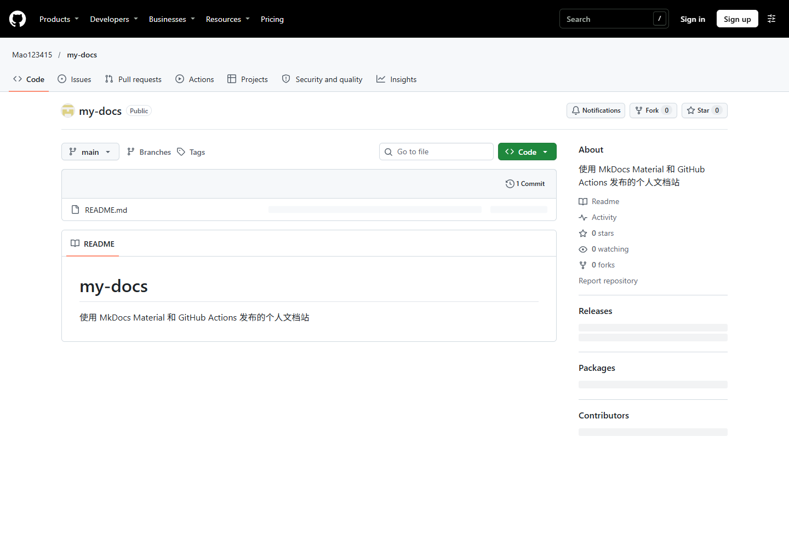
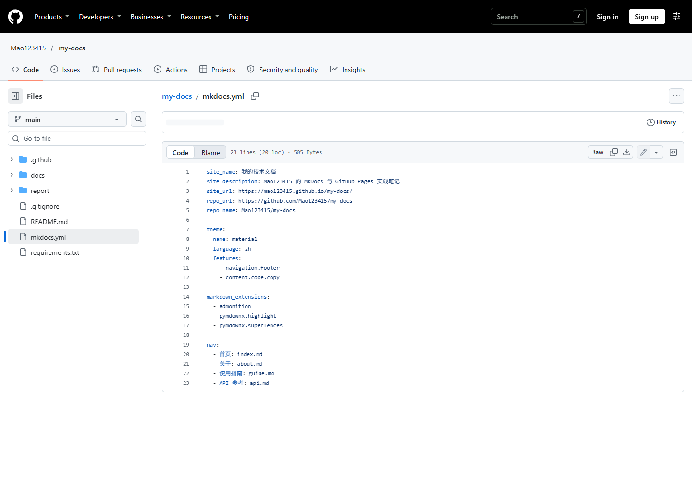
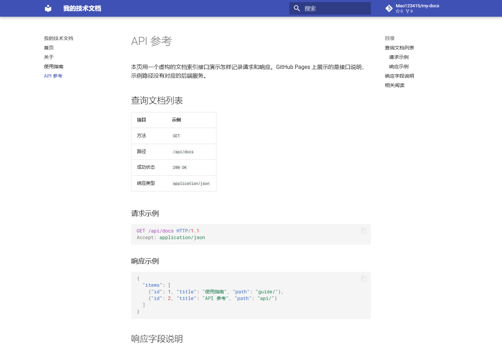
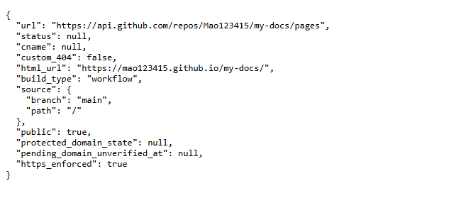
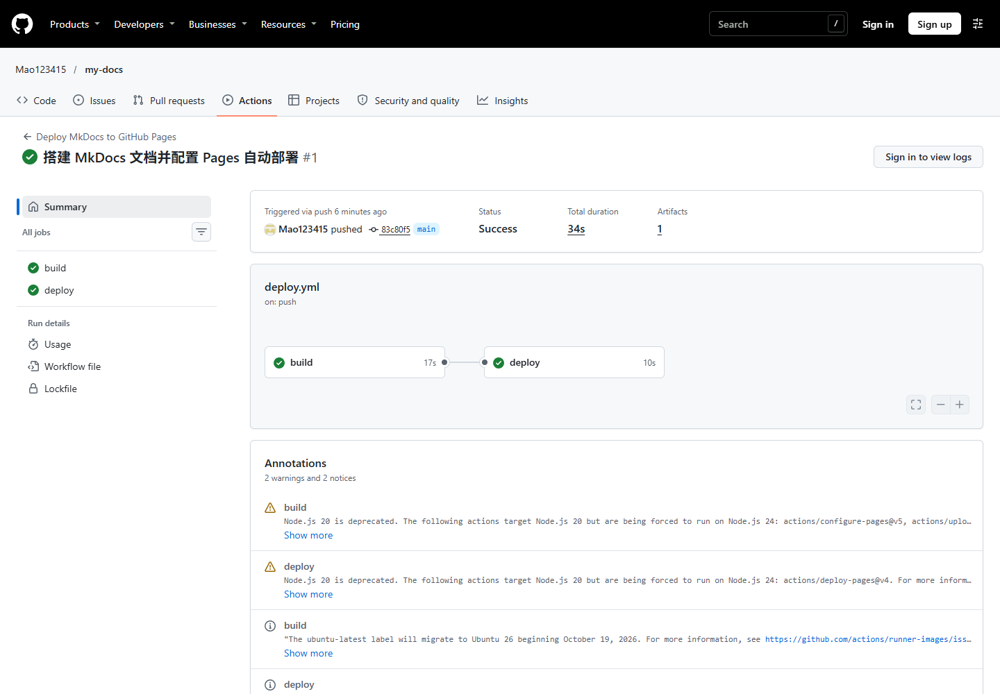
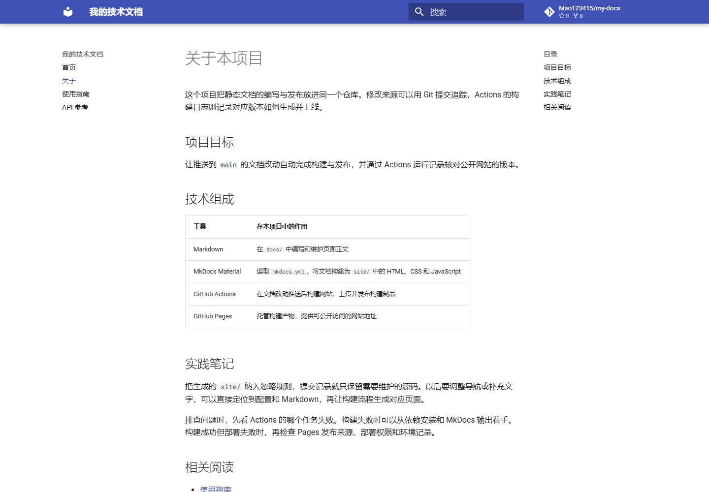
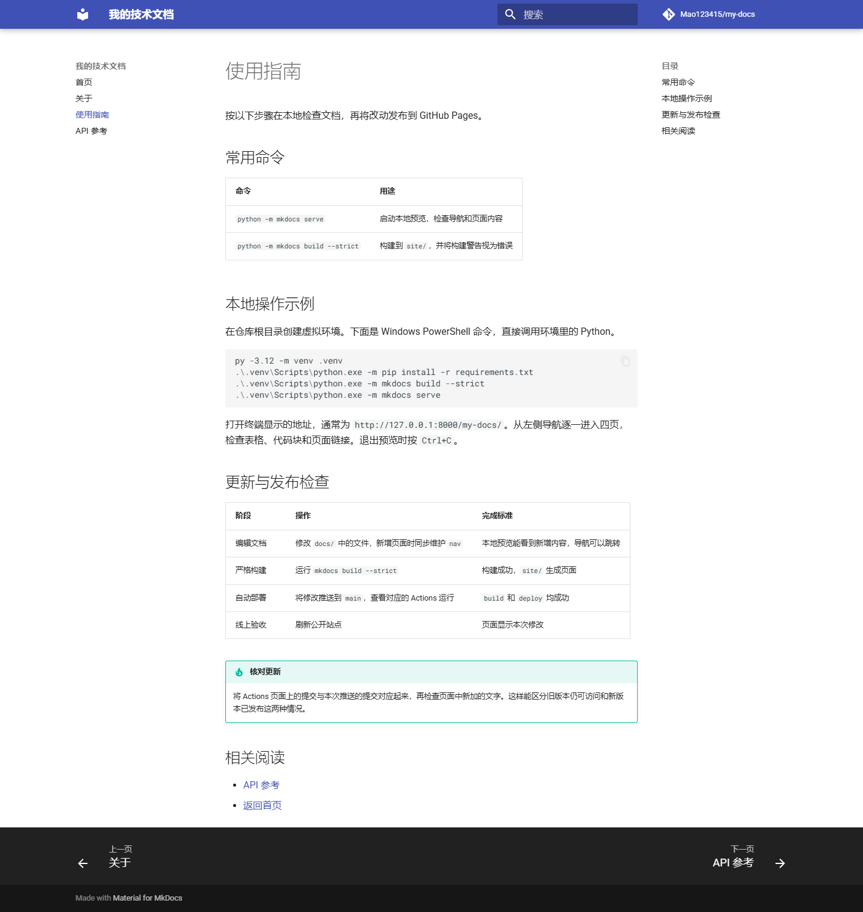
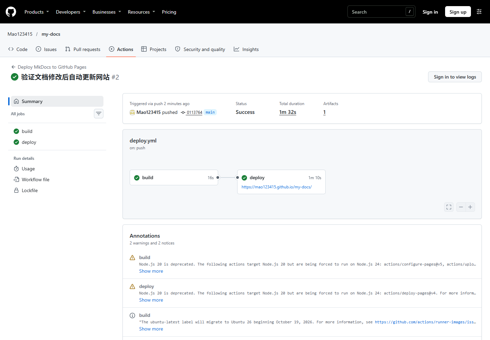
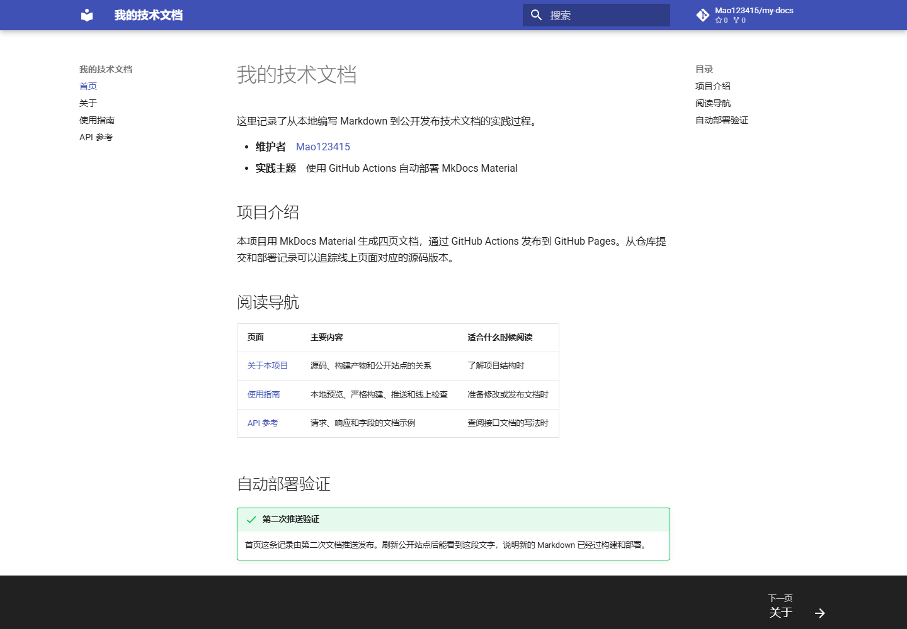

# 实践项目2：个人实验报告

## 1. 基本信息

- GitHub 登录名：`Mao123415`
- 个人仓库地址：https://github.com/Mao123415/my-docs
- 最终网站地址：https://mao123415.github.io/my-docs/

## 2. 实践过程与关键截图

### 2.1 仓库创建

在个人账号下创建公开仓库 `my-docs`，初始化 README，并克隆到本地。确认默认分支为 `main`，使源码分支与工作流中的触发分支一致。公开仓库便于从课程 Issue 直接访问源码和报告。

### 2.2 项目结构与 MkDocs 配置

在 `docs/` 中分别编写首页、关于、使用指南和 API 参考。首页的表格提供了页面入口，指南和 API 参考包含带语法高亮的示例。`mkdocs.yml` 的 `nav` 决定四页的名称和顺序，其中的文件路径以 `docs/` 为基准。`site/` 是构建时生成的目录，通过 `.gitignore` 排除。

### 2.3 本地构建或预览

在 Python 3.12.16 虚拟环境中安装 `requirements.txt` 中的依赖，运行 `python -m mkdocs build --strict`，命令成功退出。通过 `python -m mkdocs serve` 在 `http://127.0.0.1:8000/my-docs/` 预览，首页、关于、指南和 API 参考的本地地址均返回 HTTP 200。

### 2.4 Pages 设置

通过 GitHub Pages API 创建站点时指定 `build_type: workflow`，对应仓库 Pages 的 **GitHub Actions** 来源。API 返回的 `build_type` 为 `workflow`，`public` 为 `true`。下图展示真实 API 响应。

### 2.5 Actions 首次构建和部署

首次把四页文档和 `.github/workflows/deploy.yml` 推送到 `main` 后，`push` 触发构建。`build` 使用 Python 3.12 完成严格构建并上传 `site/` 制品，`deploy` 随后发布到 `github-pages` 环境。两个任务均成功。

- [首次部署提交](https://github.com/Mao123415/my-docs/commit/83c80f58f0b44820e5055ab40192ed003d82c8a6)
- [首次 Actions 运行](https://github.com/Mao123415/my-docs/actions/runs/42815900667)

### 2.6 网站访问与四页导航检查

首次部署和版式更新后，均通过公开站点核对了首页、关于、使用指南和 API 参考。四页均返回 HTTP 200。当前版式采用 Material 默认配色，桌面端左侧为全站导航，右侧为当前页目录。手机端通过页眉菜单也能跳转到 API 参考。

- 首页展示阅读导航表。
- 关于页列出项目目标、技术组成和实践笔记。
- 使用指南展示常用命令、本地操作示例和发布检查表。
- API 参考分别展示请求示例、响应示例和字段说明。

版式更新通过严格构建，推送后自动发布。[`fca1347` 版式更新提交](https://github.com/Mao123415/my-docs/commit/fca13475a7d2f1e6c379388b69d1cf7aba33cfa8) · [版式更新的 Actions 运行](https://github.com/Mao123415/my-docs/actions/runs/43841098079)

### 2.7 第二次推送与自动更新验证

在 `docs/index.md` 添加标题为“第二次推送验证”的提示块，再将改动推送到 `main`。在 Actions 运行记录中核对事件为 `push`，关联提交与此次推送一致。构建与部署均成功后，重新访问公开首页，页面显示了新增提示。

- 对应提交链接：<https://github.com/Mao123415/my-docs/commit/011376418d16b52c00ab602d94fd544ccb18f027>
- 对应 Actions 运行链接：<https://github.com/Mao123415/my-docs/actions/runs/42816431266>

## 3. 问题与解决

首次直接运行 `git push` 时，Git 连接 `github.com:443` 超时，远端 `main` 仍指向初始化提交。检查发现系统配置了 HTTP 代理，Git 的直接连接未使用它。将现有代理仅传给当次 Git 命令后重试，推送成功，并在 Actions 中找到与该提交对应的运行。

构建时主题输出了维护周期提示，严格构建成功退出。Actions 注释还提示，部分官方 Pages 操作原本面向 Node.js 20，由 runner 使用 Node.js 24 执行。首次部署、第二次推送和版式更新对应的运行中，`build` 与 `deploy` 均成功。

## 4. 原理理解

1. **`docs/` 和 `site/` 各保存什么？为什么不用手工修改 `site/`？** `docs/` 保存维护的 Markdown 源文件。`site/` 保存 MkDocs 生成的 HTML、CSS、JavaScript 等文件。直接修改产物会在下次构建时被覆盖，变更应写入源码或配置。
2. **本次工作流在什么情况下自动运行？** 推送到 `main` 且变更命中 `docs/**`、`mkdocs.yml`、`requirements.txt` 或部署工作流时自动运行。`workflow_dispatch` 另提供手动重跑入口。
3. **`build` 与 `deploy` 有什么区别？** `build` 安装依赖、严格构建并上传 `site/` 制品。`deploy` 通过 `needs: build` 等待构建成功，再使用 `pages: write` 和 `id-token: write` 权限把制品发布到 `github-pages` 环境。
4. **只修改 `report/README.md` 会触发部署吗？为什么？** 不会。`report/` 和根目录 `README.md` 都不在 `push.paths` 的触发范围内。
5. **本次方案为何无需创建 `gh-pages` 分支？** Pages 的发布来源是 GitHub Actions。官方部署操作直接发布本次上传的制品，因此 `main` 保存源码，生成的站点由构建和部署流程交接。
