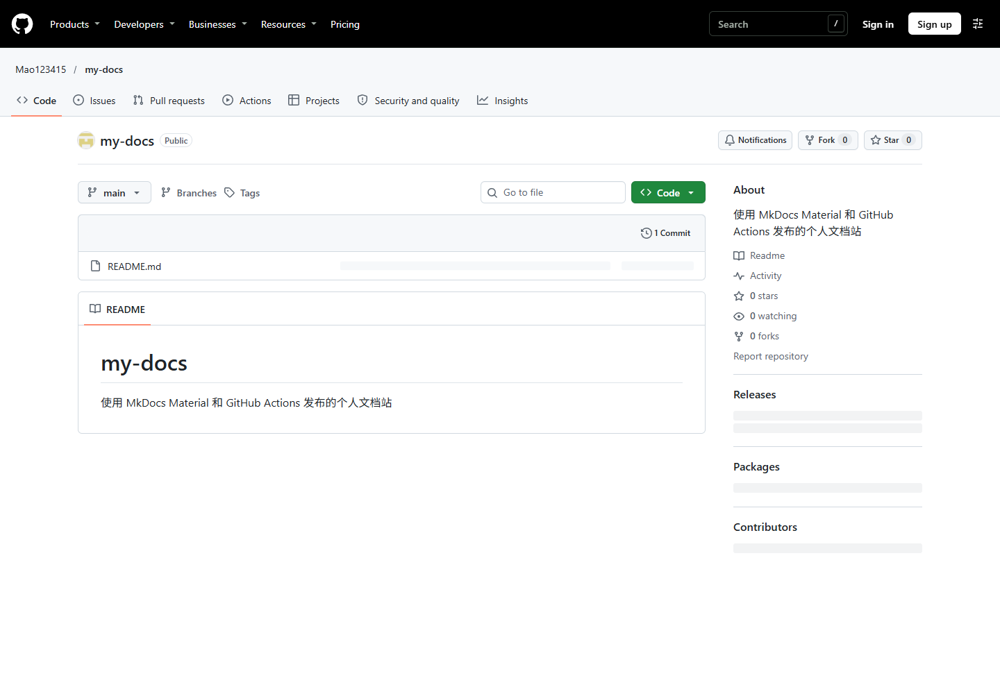
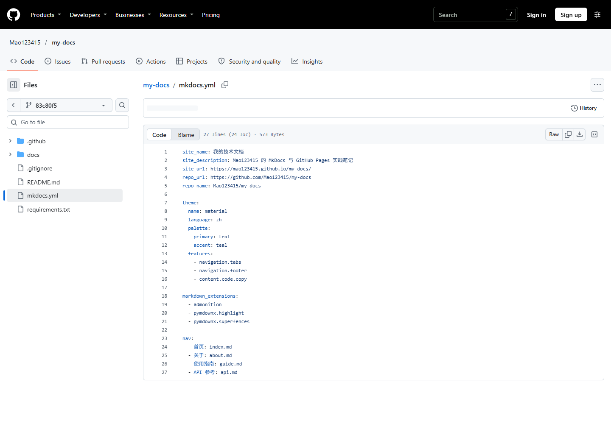
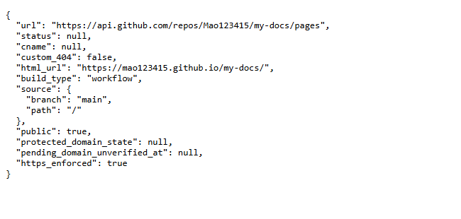
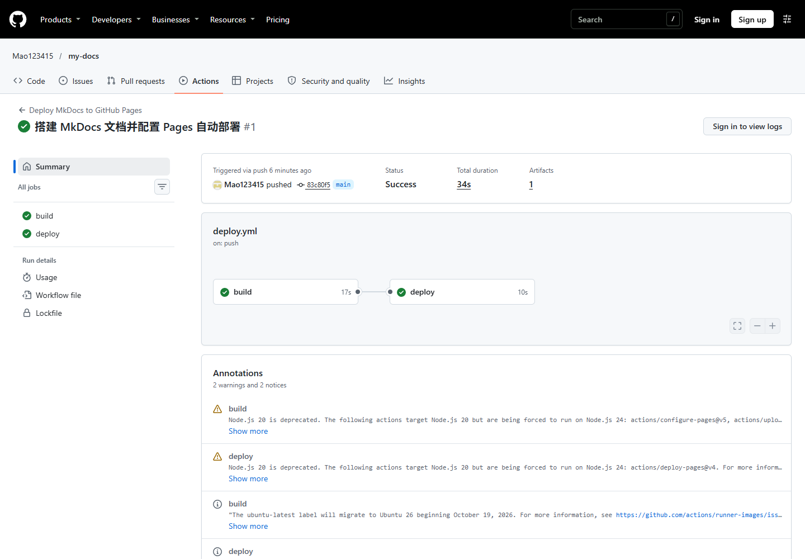
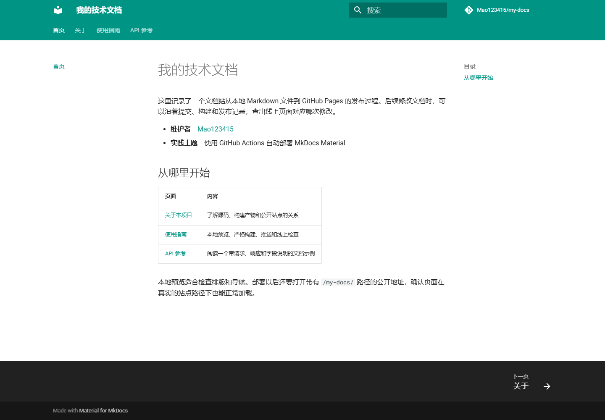
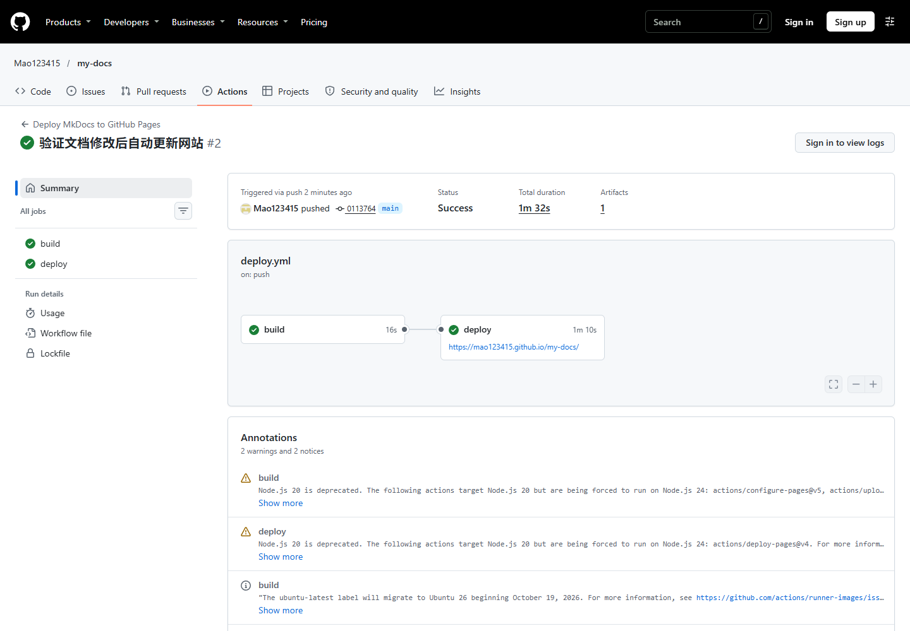
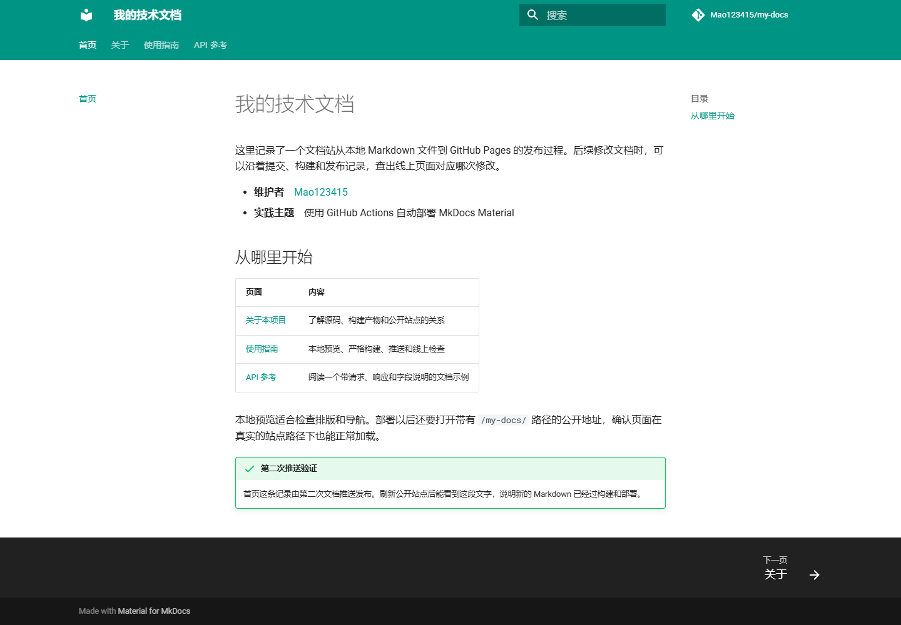

# 实践项目 2 · GitHub Pages 个人实验报告

## 1. 基本信息

- GitHub 登录名：`Mao123415`
- [个人公开仓库](https://github.com/Mao123415/my-docs)
- [GitHub Pages 网站](https://mao123415.github.io/my-docs/)
- 实验环境：Windows PowerShell、Git、Python 3.12 和 MkDocs Material。

## 2. 实践过程与关键截图

### 2.1 创建公开仓库

在个人账号下创建公开仓库 `my-docs`，初始化 README，并克隆到本地。确认默认分支为 `main`，使源码分支与工作流中的触发分支一致。公开仓库便于从课程 Issue 直接访问源码和报告。

### 2.2 编写文档和站点配置

在 `docs/` 中分别编写首页、关于、使用指南和 API 参考。首页的表格提供了页面入口，指南和 API 参考包含带语法高亮的示例。`mkdocs.yml` 的 `nav` 决定四页的名称和顺序，其中的文件路径以 `docs/` 为基准。`site/` 是构建时生成的目录，通过 `.gitignore` 排除。

### 2.3 本地严格构建与预览

在 Python 3.12.16 虚拟环境中安装 `requirements.txt` 中的依赖，运行 `python -m mkdocs build --strict`，命令成功退出。通过 `python -m mkdocs serve` 在 `http://127.0.0.1:8000/my-docs/` 预览，首页、关于、指南和 API 参考的本地地址均返回 HTTP 200。

### 2.4 设置 Pages 发布来源

通过 GitHub Pages API 创建站点时指定 `build_type: workflow`，对应仓库 Pages 的 **GitHub Actions** 来源。API 返回的 `build_type` 为 `workflow`，`public` 为 `true`。下图展示真实 API 响应。

### 2.5 首次构建和部署

首次把四页文档和 `.github/workflows/deploy.yml` 推送到 `main` 后，`push` 触发构建。`build` 使用 Python 3.12 完成严格构建并上传 `site/` 制品，`deploy` 随后发布到 `github-pages` 环境。两个任务均成功。

- [首次部署提交](https://github.com/Mao123415/my-docs/commit/83c80f58f0b44820e5055ab40192ed003d82c8a6)
- [首次 Actions 运行](https://github.com/Mao123415/my-docs/actions/runs/42815900667)

### 2.6 检查公开网站和四页导航

通过 [公开站点](https://mao123415.github.io/my-docs/) 核对首页、关于、使用指南和 API 参考。四页均返回 HTTP 200。首页保留了通往其他三页的链接，关于页有流程表格，使用指南和 API 参考分别展示命令与响应代码块。

### 2.7 第二次推送与自动更新

在 `docs/index.md` 添加标题为“第二次推送验证”的提示块，再将改动推送到 `main`。在 Actions 运行记录中核对事件为 `push`，关联提交与此次推送一致。构建与部署均成功后，重新访问公开首页，页面显示了新增提示。

- [第二次推送的提交](https://github.com/Mao123415/my-docs/commit/011376418d16b52c00ab602d94fd544ccb18f027)
- [第二次自动部署的 Actions 运行](https://github.com/Mao123415/my-docs/actions/runs/42816431266)

## 3. 问题与解决

首次直接运行 `git push` 时，Git 连接 `github.com:443` 超时，远端 `main` 仍指向初始化提交。检查发现系统配置了 HTTP 代理，Git 的直接连接未使用它。将现有代理仅传给当次 Git 命令后重试，推送成功，并在 Actions 中找到与该提交对应的运行。

构建时主题输出了维护周期提示，严格构建成功退出。Actions 注释还提示，部分官方 Pages 操作原本面向 Node.js 20，本次由 runner 使用 Node.js 24 执行。核对了 `build` 中的 Python 设置、依赖安装、严格构建和制品上传，以及 `deploy` 的完成状态。两次运行都成功。

## 4. 原理理解

1. **`docs/` 和 `site/` 各存放什么？** `docs/` 保存维护的 Markdown 源文件。`site/` 保存 MkDocs 生成的 HTML、CSS、JavaScript 等文件。直接修改产物会在下次构建时被覆盖，变更应写入源码或配置。
2. **什么时候自动运行？** 推送到 `main` 且变更命中 `docs/**`、`mkdocs.yml`、`requirements.txt` 或部署工作流时自动运行。`workflow_dispatch` 另提供手动重跑入口。
3. **`build` 与 `deploy` 有什么区别？** `build` 安装依赖、严格构建并上传 `site/` 制品。`deploy` 通过 `needs: build` 等待构建成功，再使用 `pages: write` 和 `id-token: write` 权限把制品发布到 `github-pages` 环境。
4. **只改报告会触发部署吗？** 不会。`report/` 和根目录 `README.md` 都不在 `push.paths` 的触发范围内。
5. **为什么无需创建 `gh-pages` 分支？** Pages 的发布来源是 GitHub Actions。官方部署操作直接发布本次上传的制品，因此 `main` 保存源码，生成的站点由构建和部署流程交接。
